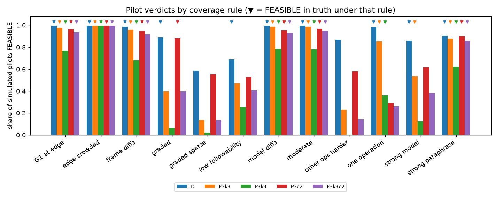
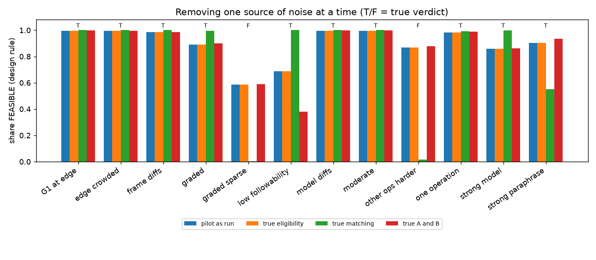
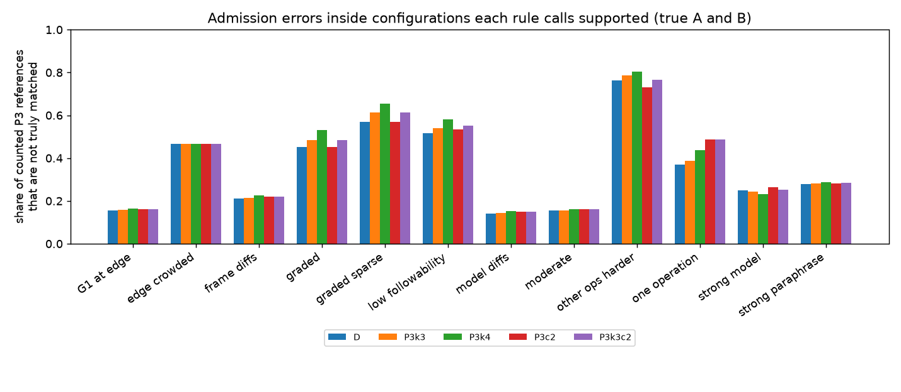
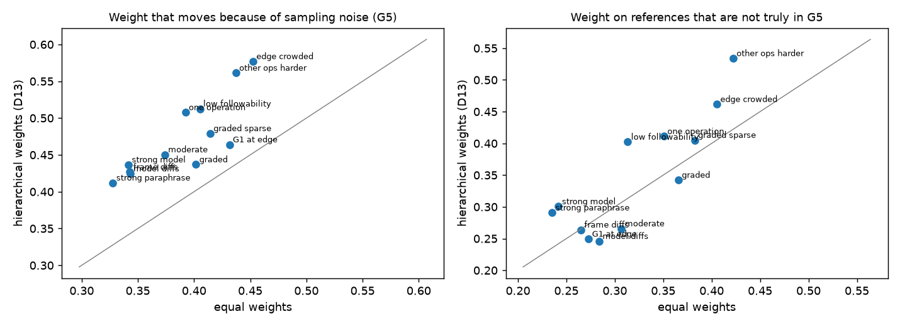
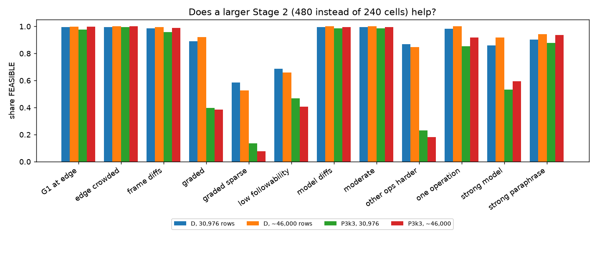

# Reference coverage (decision D11): simulation study and recommendation

**For:** the researcher, before deciding D11. **Status:** a research note.
Every number in it comes from **simulated** pilots run through the real
Batch 1 selection code on **invented** compliance rates; none is an
empirical finding about any model. Nothing here is approved, and the code
still holds the design's minimum of 2. **Date:** 2026-10-19.

Part of the Batch 1 review package; start at
[`RESEARCHER_REVIEW.md`](RESEARCHER_REVIEW.md). Terms used below are
explained in [`PROTOCOL_REVIEW.md`](PROTOCOL_REVIEW.md) §1.

---

## Summary

- **Admission is not capped.** Every reference that passes eligibility,
  compatibility and difficulty matching is kept. A minimum-coverage rule only
  decides whether a comparison is *estimable*; it never limits how many
  references are used. Two tests check this.
- **The problem the auditor found is real and comes from matching noise.**
  With 32–96 responses per instruction, deciding whether an instruction lies
  within ±10 points of A's difficulty is wrong about 45% of the time for
  instructions near that edge. Those wrong admissions can satisfy a minimum
  of 2 on their own. When we replace the noisy matching decision with the
  true one, false FEASIBLE verdicts almost disappear (87% → 2%; 59% → 0%).
  Eligibility noise contributes nothing measurable, and noise in choosing A
  and B very little.
- **No minimum-coverage rule removes the wrong admissions.** In
  configurations a rule accepts, the share of counted P3 references that are
  not truly matched is the same under every count rule (14–21% on typical
  surfaces and 45–80% when true coverage is thin). A minimum changes *which
  configurations are called estimable*, not *how clean their reference
  populations are*.
- **Recommended rule: a minimum of 3 newly admitted references for P3 only**
  (rule *P3k3*; P1 and P2 stay at 2). Of the 15 rules tested, it has the
  lowest average error among those that keep false INFEASIBLE in typical
  scenarios below 10%. Its worst case is about half the design rule's (47%
  against 87%). It cuts false FEASIBLE verdicts in thin-coverage
  scenarios from 73% to 18%, at about 1 extra point of false INFEASIBLE in
  typical scenarios. Minimums of 4 or 5 cost far more (25% and 77% false
  INFEASIBLE in typical scenarios), and a minimum of 3 for P2 is
  infeasible by construction for this library.
- **Requiring diversity across operations or families did not add
  reliability.** Wrong admissions come from several operations, so a
  diversity requirement is met by noise as easily as a count. Diversity
  changes *what P3 means* (it refuses configurations whose matched
  additions all come from one operation); that is a scientific choice, so
  it is offered as an alternative, not as the recommendation.
- **What remains:** P3k3 reduces but does not cure false feasibility (up to
  47% when true coverage sits just below 3 per configuration). Memberships
  agree with the truth only about half the time (Jaccard ≈ 0.5). Hierarchical
  weights magnify both problems when coverage is thin. The real remedy is
  more precise matching, which is a separate decision (D10) not taken here.

## 1. What scientific problem D11 solves

The confirmatory experiment (Batch 2) will measure how much adding
instruction A harms compliance with instruction B, and compare it with how
much adding *reference* instructions harms B. Which references are used
matters, so the study compares populations of references chosen by
progressively looser rules, for example:

- **P3** compares **G3** (references that do the same *operation* as A,
  counting, and are matched to A's difficulty) with **G5** (matched
  references of *any* operation).

If G5 adds no matched reference beyond G3, the comparison is empty. If it adds
one, the comparison rests on a single instruction. **D11 is the rule that
says how much a relaxed population must add before a comparison counts as
estimable in a configuration** (a configuration is one model × one wording
frame × one B limit; there are 16). The study then needs each comparison to
be estimable in at least 12 of the 16, across at least 3 models and both B
limits (the *feasibility target*).

## 2. How the current rule works: an example

Suppose that for Qwen3-4B, wording frame F0, B limit 10, the pilot measures A
("use *however* exactly 4 times") at 46% compliance. A reference is matched if
its own compliance is between 36% and 56%. Say these are matched:

| reference | operation | measured | matched? |
|---|---|---|---|
| use *indeed* exactly 4 times | exact count (as A) | 49% | yes → in G3 |
| exactly 3 commas | exact count (as A) | 40% | yes → in G3 |
| exactly 7 sentences | exact count (as A) | 52% | yes → in G3 |
| include *simple* | inclusion | 54% | yes → **added by G5** |
| every sentence ≤ 12 words | numerical bound | 38% | yes → **added by G5** |
| no repeated word pair | uniqueness | 61% | no |

The current rule (design minimum 2) says: P3 is supported here, because G3
has at least 3 members and G5 adds at least 2 references of another operation
(*include simple*, *sentence ≤ 12 words*). Under P3k3 it would need a third.

All matched references are used; the minimum never removes any.

## 3. Why the auditor found it problematic

A measured 38% may be a true 30%, and a true 30% is not matched. Near the
±10 edge the pilot cannot tell the difference reliably. If many references
sit just outside the edge, a few will be admitted by chance in every
configuration. Two chance admissions satisfy the design minimum, so a pilot
can report P3 as estimable when no matched other-operation reference exists
at all. The auditor's independent code found 24 of 30 such pilots reporting
FEASIBLE; the first precision review found 85–89%.

## 4. What was tested

**Scenarios: 12 invented "compliance surfaces".** A surface says how often
each model follows each instruction in each wording frame. The six from the
first precision review, plus six harder ones:

| scenario | what it represents |
|---|---|
| moderate | plausible rates; plenty of matched references |
| model diffs | models differ by up to 36 points overall |
| frame diffs | the two wordings change rates by up to ±8 points |
| G1 at edge | A's own-family references sit 0.04–0.16 from A |
| low followability | all references 15 points harder |
| other ops harder | every other-operation reference 20 points harder: **no truly matched one exists** |
| strong model | large model shifts plus a model × operation interaction up to ±15 points |
| strong paraphrase | under F1, every instruction (A too) moves by up to ±25 points |
| edge crowded | every reference outside A's group sits 0.06–0.14 from A: about half inside, all near the edge |
| graded | 1 to 5 truly matched other-operation references, by model and frame |
| graded sparse | as *graded* with one fewer everywhere |
| one operation | the only matched other-operation references are the four ordering instructions |

Every scenario includes topic effects: answers on the same question are
correlated, as in the real pilot.

**Rules: 15, all applied to the same simulated pilots (paired).** The
pilot's data are drawn once and every rule is evaluated on the same
populations, so differences between rules are never sampling differences.
11 are shown below; the full set (including *P3k3m07*, *P3k4c2*, *P23c2*,
*Uk4*) is in the JSON.

| rule | P1 | P2 | P3 |
|---|---|---|---|
| **D** (design, current) | ≥ 2 | ≥ 2 | ≥ 2 |
| **P3k3**, P3k4, P3k5 | ≥ 2 | ≥ 2 | ≥ 3, 4, 5 |
| P23k3 | ≥ 2 | ≥ 3 | ≥ 3 |
| Uk3 | ≥ 3 | ≥ 3 | ≥ 3 |
| P3c2 / P3k3c2 | ≥ 2 | ≥ 2 | ≥ 2 / ≥ 3, from ≥ 2 operations |
| P3f2 / P3f3 | ≥ 2 | ≥ 2 | ≥ 2 from ≥ 2 families / ≥ 3 from ≥ 3 families |
| P3m05 (exploratory) | ≥ 2 | ≥ 2 | ≥ 2, counting only references measured within 0.05 of A |

A *family* is a parameterised instruction (the three "increasing sentence
length" variants are one family); an *operation* is broader (all ordering
instructions). *P3m05* changes what counts, not who is admitted, but it uses
a second tolerance, so adopting it would also be a change to D10.

**Scale.** 1,000 independent simulated pilots per scenario at the planned
budget (12,000 pilots, about 31,000 responses each), and 500 per scenario at
a 50% larger Stage 2. With 1,000 pilots a rate is known to within ±3 points
(95% interval); intervals for every rate are in the JSON.

## 5. Ground truth: what "false FEASIBLE" means

For each scenario, the **noise-free result** is the same pipeline run on
the true rates (each instruction's compliance averaged over the whole topic
distribution, which is what an infinitely large pilot would measure). It
selects A and B, builds G1–G6, and gives each rule's verdict:

- a pilot verdict is a **false FEASIBLE** when the rule calls the study
  feasible and the same rule on the true rates does not;
- a **false INFEASIBLE** is the converse.

Because a stricter rule can be infeasible in truth where the design rule is
not, every rule is also compared with the *design rule's* truth. That shows
when a rule "avoids errors" only by refusing scenarios the design would
accept.

True verdicts:

| scenario | true A, B | true P3 support (of 16): design / P3k3 | true verdict: design / P3k3 |
|---|---|---|---|
| G1 at edge | A.however.4, [10, 12] | 16 / 16 | FEASIBLE / FEASIBLE |
| edge crowded | A.however.4, [10, 12] | 16 / 16 | FEASIBLE / FEASIBLE |
| frame diffs | A.however.4, [10, 12] | 16 / 16 | FEASIBLE / FEASIBLE |
| graded | A.however.4, [10, 12] | 14 / 10 | FEASIBLE / INFEASIBLE |
| graded sparse | A.however.4, [10, 12] | 10 / 6 | INFEASIBLE / INFEASIBLE |
| low followability | A.however.4, [10, 12] | 14 / 8 | FEASIBLE / INFEASIBLE |
| model diffs | A.however.4, [9, 11] | 16 / 16 | FEASIBLE / FEASIBLE |
| moderate | A.however.4, [10, 12] | 16 / 16 | FEASIBLE / FEASIBLE |
| other ops harder | A.however.4, [10, 12] | 0 / 0 | INFEASIBLE / INFEASIBLE |
| one operation | A.however.4, [10, 12] | 16 / 16 | FEASIBLE / FEASIBLE |
| strong model | A.however.4, [9, 11] | 12 / 12 | FEASIBLE / FEASIBLE |
| strong paraphrase | A.however.6, [10, 12] | 16 / 16 | FEASIBLE / FEASIBLE |

## 6. Results

### 6.1 Verdicts by rule

Share of 1,000 pilots that report FEASIBLE. **Bold** = the rule's own truth is
FEASIBLE (so a high number is good); plain = truth INFEASIBLE (a high number is
false FEASIBLE).

| scenario | D | P3k3 | P3k4 | P3k5 | P23k3 | Uk3 | P3c2 | P3k3c2 | P3f2 | P3f3 | P3m05 |
|---|---|---|---|---|---|---|---|---|---|---|---|
| G1 at edge | **100%** | **98%** | **77%** | **25%** | **90%** | **90%** | **97%** | **94%** | **98%** | **47%** | **59%** |
| edge crowded | **99%** | **99%** | **99%** | **99%** | **85%** | **85%** | **99%** | **99%** | **99%** | **99%** | 97% |
| frame diffs | **98%** | **96%** | **68%** | **14%** | **58%** | **58%** | **95%** | **92%** | **96%** | 27% | **54%** |
| graded | **89%** | 40% | 6% | 1% | 35% | 35% | **88%** | 40% | **88%** | 33% | 10% |
| graded sparse | 59% | 14% | 2% | 1% | 12% | 12% | 55% | 14% | 57% | 12% | 2% |
| low followability | **69%** | 47% | 25% | 6% | 27% | 27% | 53% | 41% | 53% | 9% | 22% |
| model diffs | **100%** | **98%** | **78%** | **27%** | 81% | 81% | **96%** | **93%** | **96%** | **41%** | **59%** |
| moderate | **100%** | **99%** | **78%** | **24%** | **84%** | **84%** | **97%** | **95%** | **98%** | **49%** | **61%** |
| other ops harder | 87% | 23% | 0% | 0% | 19% | 19% | 58% | 14% | 58% | 0% | 1% |
| one operation | **98%** | **85%** | **36%** | 6% | **74%** | **74%** | 29% | 26% | **83%** | 18% | **34%** |
| strong model | **86%** | **53%** | 12% | 1% | 23% | 23% | 62% | 38% | 63% | 8% | 11% |
| strong paraphrase | **90%** | **88%** | **62%** | **21%** | **42%** | **42%** | **90%** | **86%** | **90%** | **64%** | **50%** |



Summary. *Mean* and *worst error* are against each rule's own truth, over the
12 scenarios. *Thin coverage* averages *other ops harder* and *graded sparse*
(both INFEASIBLE in the design's truth). *Typical* averages *moderate*,
*model diffs*, *frame diffs* and *G1 at edge* (all FEASIBLE in every rule's
truth except where stated). The last two columns are against the design
rule's truth.

| rule | what it requires (P3 unless stated) | scenarios FEASIBLE in truth | mean error | worst error | false FEASIBLE, thin coverage | false INFEASIBLE, typical |
|---|---|---|---|---|---|---|
| D | P1: >= 2; P2: >= 2; P3: >= 2 | 10 of 12 | 18% | 87% | 73% | 1% |
| P3k3 | P1: >= 2; P2: >= 2; P3: >= 3 | 8 of 12 | 17% | 47% | 18% | 2% |
| P3k4 | P1: >= 2; P2: >= 2; P3: >= 4 | 7 of 12 | 21% | 64% | 1% | 25% |
| P3k5 | P1: >= 2; P2: >= 2; P3: >= 5 | 6 of 12 | 34% | 86% | 0% | 77% |
| P23k3 | P1: >= 2; P2: >= 3; P3: >= 3 | 6 of 12 | 30% | 81% | 15% | 22% |
| Uk3 | P1: >= 3; P2: >= 3; P3: >= 3 | 6 of 12 | 30% | 81% | 15% | 22% |
| P3c2 | P1: >= 2; P2: >= 2; P3: >= 2, >= 2 categories | 7 of 12 | 25% | 62% | 57% | 4% |
| P3k3c2 | P1: >= 2; P2: >= 2; P3: >= 3, >= 2 categories | 6 of 12 | 18% | 41% | 14% | 7% |
| P3f2 | P1: >= 2; P2: >= 2; P3: >= 2, >= 2 families | 8 of 12 | 24% | 63% | 58% | 3% |
| P3f3 | P1: >= 2; P2: >= 2; P3: >= 3, >= 3 families | 5 of 12 | 26% | 59% | 6% | 59% |
| P3m05 | P1: >= 2; P2: >= 2; P3: >= 2, |diff| <= 0.05 | 6 of 12 | 36% | 97% | 2% | 42% |

Reading the table:

- **The design rule (D)** almost never misses a feasible study (1%) but
  reports FEASIBLE in 73% of thin-coverage pilots, up to 87%.
- **P3k3** brings thin-coverage false FEASIBLE down to 18% at a cost of 1
  extra point in typical scenarios, and halves the worst case. Its own truth
  is stricter in two scenarios (*graded*, *low followability*): there it
  calls a study infeasible that the design rule would accept.
- **P3k4 and P3k5** nearly eliminate false FEASIBLE, but miss a feasible
  study in 25% and 77% of typical pilots. That is too high a price.
- **P3 diversity rules (P3c2, P3f2)** barely help (57–58% false FEASIBLE
  with thin coverage): false admissions come from several operations, so
  diversity is satisfied by noise. P3k3c2 behaves like P3k3 plus a stricter
  definition (see §7).
- **Raising P2 (P23k3, Uk3)** costs 22% false INFEASIBLE in typical
  scenarios. The library has only 8 exact-count references of another object
  type (4 punctuation, 2 sentence-count, 2 paragraph-count), so a minimum of 3
  is often impossible in truth: "where scientifically applicable", P2's
  minimum should stay at 2.
- **P23k3 and Uk3 are identical** in every scenario: P1's additions are
  unmatched references, which are always plentiful.
- **P3m05** removes false FEASIBLE but loses 42% of feasible studies and,
  in *edge crowded*, reports FEASIBLE in 97% of pilots against a truth that
  is INFEASIBLE under its own stricter count.

### 6.2 Where the errors come from

Each pilot was re-evaluated with one source of noise removed (design rule).
"True matching" means G1–G6 are built from the true rates with the pilot's
own A, B and eligibility.

| scenario | true verdict | as run | true eligibility | true matching | true A and B |
|---|---|---|---|---|---|
| G1 at edge | FEASIBLE | 100% | 100% | 100% | 100% |
| edge crowded | FEASIBLE | 99% | 99% | 100% | 100% |
| frame diffs | FEASIBLE | 98% | 98% | 100% | 99% |
| graded | FEASIBLE | 89% | 89% | 99% | 90% |
| graded sparse | INFEASIBLE | 59% | 59% | 0% | 59% |
| low followability | FEASIBLE | 69% | 69% | 100% | 38% |
| model diffs | FEASIBLE | 100% | 100% | 100% | 100% |
| moderate | FEASIBLE | 100% | 100% | 100% | 100% |
| other ops harder | INFEASIBLE | 87% | 87% | 2% | 88% |
| one operation | FEASIBLE | 98% | 98% | 99% | 99% |
| strong model | FEASIBLE | 86% | 86% | 100% | 86% |
| strong paraphrase | FEASIBLE | 90% | 90% | 55% | 93% |



- **Matching noise is the cause.** With true matching, false FEASIBLE
  falls from 87% to 2% and from 59% to 0%, and false INFEASIBLE disappears
  (*low followability* 69% → 100%, *strong model* 86% → 100%).
- **Eligibility noise (the 20% rule) contributes nothing to verdict
  errors.** With true eligibility, every number is unchanged. Pilots do
  misclassify about 0–1.6 references per pilot near 20%, but those references
  are rarely also matched.
- **A and B selection noise matters little,** except when A itself is hard
  to pick: in *low followability* the pilot picks the true A in 61% of runs,
  and in *strong paraphrase* in 55%. In *strong paraphrase*, "true matching"
  lowers the FEASIBLE rate, because many pilots chose a different A from the
  truth and the references truly matched to that A are fewer.

How often matching is wrong, by the reference's true distance from the
±0.10 edge, and how many of the references that the comparisons count are
wrongly admitted (with the true A and B):

| scenario | wrong when within 0.02 of the edge | 0.02–0.05 | beyond 0.05 | P2 additions not truly matched | P3 additions not truly matched | eligibility errors per pilot |
|---|---|---|---|---|---|---|
| G1 at edge | 45% | 39% | 6% | 21% | 16% | 1.4 |
| edge crowded | 45% | 36% | 25% | 37% | 47% | 0.0 |
| frame diffs | 45% | 34% | 14% | 34% | 21% | 1.6 |
| graded | 45% | 33% | 16% | 40% | 44% | 0.0 |
| graded sparse | 45% | 33% | 15% | 41% | 55% | 0.0 |
| low followability | 45% | 35% | 9% | 31% | 52% | 0.5 |
| model diffs | 45% | 33% | 12% | 38% | 14% | 0.0 |
| moderate | 45% | 35% | 14% | 41% | 16% | 1.4 |
| other ops harder | 44% | 33% | 13% | 40% | 75% | 0.2 |
| one operation | 45% | 33% | 17% | 40% | 37% | 0.0 |
| strong model | 44% | 31% | 10% | 30% | 27% | 0.0 |
| strong paraphrase | 45% | 34% | 11% | 22% | 28% | 0.8 |

### 6.3 Configuration by configuration

With the true A and B held fixed: how often a configuration that is truly
unsupported is called supported, how many truly supported configurations
are found, and how clean the counted references are.

| scenario | P3 configurations wrongly called supported: design / P3k3 / P3k4 | truly supported configurations found: design / P3k3 / P3k4 | counted P3 references not truly matched: design / P3k3 |
|---|---|---|---|
| G1 at edge | — / — / — | 99% / 94% / 80% | 16% / 16% |
| edge crowded | — / — / — | 100% / 100% / 100% | 47% / 47% |
| frame diffs | — / — / — | 98% / 92% / 75% | 21% / 21% |
| graded | 50% / 43% / 33% | 89% / 79% / 70% | 45% / 48% |
| graded sparse | 45% / 36% / 30% | 87% / 77% / 77% | 57% / 61% |
| low followability | 77% / 53% / 28% | 83% / 61% / — | 52% / 54% |
| model diffs | — / — / — | 99% / 94% / 80% | 14% / 14% |
| moderate | — / — / — | 99% / 94% / 79% | 16% / 16% |
| other ops harder | 84% / 57% / 28% | — / — / — | 76% / 79% |
| one operation | — / — / — | 95% / 83% / 63% | 37% / 39% |
| strong model | 69% / 40% / 26% | 92% / 82% / 80% | 25% / 24% |
| strong paraphrase | — / — / — | 98% / 93% / 80% | 28% / 28% |



**The key result for D11:** the share of counted P3 references that are not
truly matched is essentially the same under D and P3k3 in every scenario.
Stricter minimums refuse more thin configurations, but the configurations
they accept contain the same proportion of wrong references.

### 6.4 Stability: how much changes with sampling noise alone

How often the pilot's A and B equal the noise-free choice; the overlap
(Jaccard: 1 = identical, 0 = disjoint) between the pilot's G1, G3 and G5 and
the noise-free ones (true A and B held fixed); and how often two independent
pilots of the same scenario would reach the same verdict.

| scenario | A as in truth | B as in truth | G1 | G3 | G5 | two pilots agree (design) | two pilots agree (P3k3) |
|---|---|---|---|---|---|---|---|
| G1 at edge | 97% | 90% | 0.43 | 0.44 | 0.47 | 99% | 95% |
| edge crowded | 99% | 88% | 0.50 | 0.48 | 0.43 | 99% | 99% |
| frame diffs | 99% | 88% | 0.55 | 0.55 | 0.56 | 97% | 92% |
| graded | 99% | 87% | 0.51 | 0.50 | 0.50 | 81% | 52% |
| graded sparse | 99% | 91% | 0.51 | 0.50 | 0.49 | 51% | 76% |
| low followability | 61% | 88% | 0.58 | 0.57 | 0.51 | 57% | 50% |
| model diffs | 100% | 80% | 0.54 | 0.53 | 0.55 | 99% | 97% |
| moderate | 99% | 87% | 0.50 | 0.49 | 0.52 | 99% | 97% |
| other ops harder | 98% | 89% | 0.51 | 0.50 | 0.46 | 77% | 65% |
| one operation | 99% | 89% | 0.51 | 0.50 | 0.51 | 96% | 75% |
| strong model | 100% | 91% | 0.60 | 0.58 | 0.57 | 76% | 50% |
| strong paraphrase | 55% | 88% | 0.61 | 0.60 | 0.58 | 83% | 79% |

G2, G4 and G6 are almost exactly reproduced (Jaccard ≈ 1.0): they do not
depend on matching. **The matched populations G1, G3 and G5 overlap the
truth only about half the time**, in every scenario. That is the same ±0.10
noise again.

### 6.5 Hierarchical weighting

Within a population, weight is split equally over operations, then object
types, then variants (D13). An operation represented by a single reference
therefore gets a whole operation's share.

| scenario | G5 weight on wrong members: hierarchical / equal | G5 weight that moves with noise: hierarchical / equal | largest single weight in G5 | weight on one-member operations |
|---|---|---|---|---|
| G1 at edge | 25% / 27% | 46% / 43% | 24% | 24% |
| edge crowded | 46% / 41% | 58% / 45% | 16% | 33% |
| frame diffs | 26% / 26% | 43% / 34% | 24% | 22% |
| graded | 34% / 37% | 44% / 40% | 28% | 55% |
| graded sparse | 41% / 38% | 48% / 41% | 30% | 50% |
| low followability | 40% / 31% | 51% / 41% | 31% | 38% |
| model diffs | 25% / 28% | 42% / 34% | 24% | 22% |
| moderate | 27% / 31% | 45% / 37% | 24% | 24% |
| other ops harder | 53% / 42% | 56% / 44% | 32% | 42% |
| one operation | 41% / 35% | 51% / 39% | 24% | 25% |
| strong model | 30% / 24% | 44% / 34% | 27% | 26% |
| strong paraphrase | 29% / 24% | 41% / 33% | 25% | 45% |



- **Yes, small categories carry disproportionate weight.** In G5, operations
  represented by one reference carry 22–55% of the total weight; the largest
  single reference carries 16–32%.
- **This magnifies membership noise.** The weight that moves between the
  pilot and the truth is higher under hierarchical weights than under equal
  weights in every scenario (41–58% against 33–45%).
- **When coverage is thin it also magnifies contamination.** In *other ops
  harder* 53% of G5's weight sits on wrongly admitted references, against 42%
  with equal weights; in typical scenarios the order is reversed (27% against
  31%).

This is a property of D13, which follows the design brief; nothing was
changed. Two mitigations are noted for the confirmatory analysis plan:
report each population's effective number of references, and a
leave-one-reference-out sensitivity.

### 6.6 Would a larger budget help?

Stage 2 with 480 refined cells instead of 240 (46,336 responses instead of
30,976; 500 pilots per scenario). "True: FEASIBLE" refers to the design
rule's truth; for P3k3 and P3k4 see the truth table in §5.

| scenario | design: 30,976 rows → 46,336 | P3k3 | P3k4 | P3 additions not truly matched (design) |
|---|---|---|---|---|
| G1 at edge (true: FEASIBLE) | 100% → 100% | 98% → 100% | 77% → 90% | 16% → 13% |
| edge crowded (true: FEASIBLE) | 99% → 100% | 99% → 100% | 99% → 100% | 47% → 45% |
| frame diffs (true: FEASIBLE) | 98% → 100% | 96% → 99% | 68% → 83% | 21% → 18% |
| graded (true: FEASIBLE) | 89% → 92% | 40% → 39% | 6% → 6% | 44% → 34% |
| graded sparse | 59% → 53% | 14% → 8% | 2% → 0% | 55% → 45% |
| low followability (true: FEASIBLE) | 69% → 66% | 47% → 41% | 25% → 23% | 52% → 45% |
| model diffs (true: FEASIBLE) | 100% → 100% | 98% → 100% | 78% → 91% | 14% → 12% |
| moderate (true: FEASIBLE) | 100% → 100% | 99% → 100% | 78% → 92% | 16% → 13% |
| other ops harder | 87% → 85% | 23% → 18% | 0% → 0% | 75% → 72% |
| one operation (true: FEASIBLE) | 98% → 100% | 85% → 92% | 36% → 45% | 37% → 28% |
| strong model (true: FEASIBLE) | 86% → 92% | 53% → 60% | 12% → 10% | 27% → 23% |
| strong paraphrase (true: FEASIBLE) | 90% → 94% | 88% → 94% | 62% → 73% | 28% → 24% |



50% more data removes 3–10 points of contamination and some false INFEASIBLE
under strict rules, but leaves the design rule's false FEASIBLE rate at 85%
in *other ops harder*. Budget is not the lever: the first precision review
reached the same conclusion for seven allocations.

### 6.7 The near-threshold flag

Freeze 2 now flags a FEASIBLE verdict whose weakest comparison is supported
in at most 14 of 16 configurations (re-audit R4.5; for review, not a
gate). Design rule:

| scenario | near-threshold flag raised on a FEASIBLE pilot | false FEASIBLE without the flag |
|---|---|---|
| G1 at edge | 30% | — |
| edge crowded | 30% | — |
| frame diffs | 45% | — |
| graded | 72% | — |
| graded sparse | 56% | 3% |
| low followability | 47% | — |
| model diffs | 34% | — |
| moderate | 33% | — |
| other ops harder | 68% | 19% |
| one operation | 50% | — |
| strong model | 76% | — |
| strong paraphrase | 68% | — |

The flag catches most false FEASIBLE verdicts (*other ops harder*: 68 of the
87 points; *graded sparse*: 56 of 59). However, it also fires on 30–76% of
correct FEASIBLE verdicts, so it signals "look closely", not "wrong".

## 7. Trade-offs

| consideration | design (≥2) | **P3k3 (recommended)** | P3k4 | P3k3c2 (alternative) |
|---|---|---|---|---|
| false FEASIBLE when true coverage is absent or thin | 73% (worst 87%) | 18% (worst 47%) | 1% | 14% |
| false INFEASIBLE in typical scenarios | 1% | 2% | 25% | 7% |
| truly supported configurations found (typical) | 98–99% | 92–94% | 75–80% | 87–91% |
| cleanliness of the counted references | unchanged | unchanged | unchanged | unchanged |
| reference diversity required | none | none | none | ≥ 2 operations |
| generation cost | same | same | same | same |
| changes what "estimable" means | — | yes: needs 3 | yes: needs 4 | yes: needs 3, from 2 operations |

No rule changes the generation budget: the rule is applied after the pilot.
A larger pilot helps only modestly (§6.6).

## 8. Recommendation

**Adopt P3k3: P3 is estimable in a configuration only when G5 adds at least
3 matched references of another operation (G3 must still have at least 3).
Keep P1 (≥ 2 additions), P2 (≥ 2 of another object type), G1 (≥ 3 distinct
words) and the 12-of-16 target unchanged. Keep admission as it is: every
qualifying reference is used.**

Why this rule:

1. **It addresses the failure the auditor found, where it occurs.** False
   FEASIBLE falls from 73% to 18% when true coverage is thin, and the worst
   case halves.
2. **It costs little where coverage is adequate:** about 1 extra point of
   false INFEASIBLE in typical scenarios, against 25% for a minimum of 4.
3. **It is the smallest change that works,** and it changes only the one
   comparison where the failure was found. P2 cannot carry a minimum of 3
   with this library. P1's additions are the *unmatched* references of A's
   own kind; there are always about 12 of them, so its minimum never binds.
4. **It was not chosen to maximise feasibility.** It makes FEASIBLE rarer.
   It was chosen for its error against its own noise-free truth: the lowest
   average (17%) among rules that rarely refuse a feasible study, and a worst
   case (47%) second only to P3k3c2 (41%). Rules with lower averages (P3k4c2,
   17%; a minimum of 4 everywhere, 12%) get there by refusing 26–85% of
   typical feasible studies.

**If you want P3 to mean "more than one other operation",** adopt P3k3c2
instead (≥ 3 additions from ≥ 2 operations). It is about as reliable (mean
error 18%, worst 41%) but stricter in meaning: it calls a configuration
unsupported when all matched additions are, say, ordering instructions. That
is a judgement about the estimand, not about noise.

**What P3k3 does not do:** it does not make the populations cleaner.
14–21% of counted P3 references are wrongly admitted in typical scenarios and
45–80% when coverage is thin, under any minimum. Read a FEASIBLE verdict with
the near-threshold flag, the D14 stability report and the Stage-1-only
sensitivity.

**A separate question for later (D10, not decided here).** The root cause is
the precision of the ±0.10 matching decision near its edge. Options that would
address it include more responses for cells near the matching edge, or a
matching rule that uses the uncertainty. Each is a change to D10 and would
need its own review. None is proposed for Freeze 1.

**To adopt it:** change `p3_min_additional_other_operation` from 2 to 3 in
`src/dci/batch1/config.py` and regenerate the review artifacts. The D11
payload hash changes, so the approval you give names the rule you chose.

## 9. What remains uncertain until real pilot data exist

- **The surfaces are invented.** They span plausible and adversarial cases,
  but the real pilot's rates may be unlike all twelve. The size of the
  matching problem depends on how many references sit near A's difficulty,
  which only the pilot will show.
- **Topic effects are modelled with assumed sizes** (SDs 0.5 and 0.3 on the
  logit scale). Real topic-to-topic variation could be larger or smaller.
- **The model × operation interactions** in *strong model* are one invented
  pattern among many.
- **The study does not simulate Batch 2 outcomes.** It measures whether
  populations and verdicts are right, not how precise the eventual
  interference comparisons will be. A supported comparison can still be
  imprecise.

## 10. Files and how to reproduce

| file | content |
|---|---|
| [`coverage_simulation.json`](coverage_simulation.json) | every rate above, with 95% intervals, per scenario and rule, at the planned budget (1,000 pilots per scenario) |
| [`coverage_simulation_cap480.json`](coverage_simulation_cap480.json) | the same at a 480-cell Stage 2 (500 per scenario) |
| [`figures/`](figures/) | the five figures |
| [`src/dci/batch1/coverage_study.py`](../../src/dci/batch1/coverage_study.py) | the rules, ground truth, oracle decomposition, tables and figures |
| [`src/dci/batch1/simulate.py`](../../src/dci/batch1/simulate.py) | the scenarios (`SURFACES`, `CHALLENGE_SURFACES`) and the simulated pilot |
| [`tests/batch1/test_coverage_rules.py`](../../tests/batch1/test_coverage_rules.py) | no cap on admission; the design rule equals the pipeline's; paired evaluation; scenario truths |
| [`CALIBRATION_PRECISION_REVIEW.md`](CALIBRATION_PRECISION_REVIEW.md) | the first precision review (allocations, D07, D14) |

```bash
.venv/bin/python -m dci.batch1.coverage_study --reps 1000 --workers 8 --out docs/batch1/coverage_simulation.json
.venv/bin/python -m dci.batch1.coverage_study --reps 500 --workers 8 --allocation current_32_plus_480x64 --out docs/batch1/coverage_simulation_cap480.json
.venv/bin/python -m dci.batch1.coverage_study --out docs/batch1/coverage_simulation.json --cost docs/batch1/coverage_simulation_cap480.json --tables
.venv/bin/python -m dci.batch1.coverage_study --out docs/batch1/coverage_simulation.json --cost docs/batch1/coverage_simulation_cap480.json --figures docs/batch1/figures
```

The runs take about 17 and 8 minutes on 8 CPU cores and are deterministic
(seeds derived from the scenario, allocation and replicate number).
